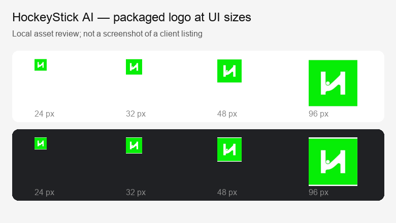

# SLACK-218 branding verification

19 October 2026 (Brisbane). This is local client/runtime and packaging evidence;
it is not a live claude.ai, Claude Desktop or Codex graphical listing acceptance.

## Supported surfaces

| Surface | Change | Evidence / limit |
| --- | --- | --- |
| Codex plugin listing | `interface.displayName` = HockeyStick AI; `logo` and `composerIcon` reference the packaged JPEG | Desktop-bundled app-server `plugin/list` returns the display name and resolved, existing image paths; no marketplace load errors |
| Codex marketplace title | `interface.displayName` = HockeyStick AI | Same runtime inventory |
| Claude plugin / marketplace entry | `displayName` = HockeyStick AI; customer-facing descriptions and publisher text updated | Claude Code 2.1.296 `plugin details` prints `HockeyStick AI (hockeystick)` |
| Anthropic directory listing icon | Plugin manifest `icon` references the same packaged JPEG | Supported directory metadata; actual submitted directory rendering remains unverified |
| Claude Code runtime icon | No custom icon rendered by this metadata | Official reference says Claude Code ignores directory `icon` at runtime |
| Shared skill heading | HockeyStick AI | Internal skill name and commands remain `hockeystick` |
| MCP-advertised metadata | No server change | Existing server identifies as `hockeystick-mcp` 0.1.0 without display title or icons. Plugin branding needs no endpoint change or deployment. Existing service connector / consent labels are outside this change |

Official references checked on 19 October 2026:

- [OpenAI plugin packaging and paths](https://developers.openai.com/plugins/build/plugins)
- [OpenAI listing image requirements](https://developers.openai.com/plugins/deploy/submission)
- [Claude manifest displayName and directory icon](https://code.claude.com/docs/en/plugins-reference)

The source logo is the existing `frontend/public/hockeystick-icon.jpg` from
`CrewAmp/hockeystickai` (app source base `932317eb97897d2c7c3a0eb06eeb1a30f1164393`).
It is copied byte-for-byte: 200 × 200 JPEG, SHA-256
`053fcde1a9a2323a12f7f0302b9a2e9b046a92516cd5beb74670f725aaf9e067`.
The mark remains recognizable at 24, 32, 48 and 96 px on light and dark backgrounds:

## Validation

- Public repository base: `514d5c3d2a690e9c8fda361cb7c080a1d707cc37`.
- Claude Code 2.1.296: plugin and marketplace `claude plugin validate --json`
  succeed with zero errors and only the existing no-version warning. `--strict`
  fails solely on that warning. Versionless behavior is intentional; adding a
  version would change the current update contract.
- Fresh isolated Claude profile: marketplace add, install under
  `hockeystick@hockeystick`, list and details succeed. Inventory still contains
  one skill and the `hockeystick` MCP server.
- Codex CLI 0.162.1: fresh isolated profile marketplace add, plugin add and list
  succeed; enabled plugin ID remains `hockeystick@hockeystick`, version `local`,
  authentication `ON_USE`.
- Desktop-bundled Codex 0.162.0-alpha.17.2: app-server inventory resolves both
  icon fields and the marketplace/plugin display names. A fresh unauthenticated
  OAuth probe reaches the Test sign-in page (HTTP 200, email input present).
  Effective request still uses the admitted Codex client, loopback port 6279,
  `hsai.read hsai.write`, Test MCP resource and S256 PKCE. No sign-in completed;
  no authenticated tool call was made.
- Existing app marketplace suite: all 6 tests pass on Vitest 4.1.11 / Node
  22.21.1. Only its two previous display-name assertions needed updating. Because
  this checkout has no managed `mcp/node_modules`, the run used the existing
  linked backend Vitest with a temporary config alias; no dependencies installed.
- Both MCP configuration files are byte-identical to the public base. Internal
  names, URLs, OAuth settings, scopes, policies and skill/tool contracts retain
  their existing values.
- All JSON parses; packaged image exists, meets the square/minimum-size rules,
  and matches its source hash. `git diff --check` passes.

Profiles and raw local receipts are task-owned under
`/private/tmp/slack-218-evidence`; no installed user plugin profile was replaced.
The initial sandboxed OAuth probe could not reach the network; the successful
probe above was repeated with network access.

## Delivery and remaining acceptance

The app source under `clients/plugins` mirrors this repository because
`publish-plugins.yml` republishes that entire directory. A companion app PR is
required to prevent a later source publish from reverting this branding.
The existing workflow is unchanged; neither PR should be self-merged.

Before closing SLACK-218, review/merge the focused PRs, refresh the marketplace,
and capture the visible name/logo in Codex's graphical plugin listing/composer
and the available Claude hosted listing. Confirm which Claude surface actually
renders the directory icon; Claude Code's runtime icon is a documented platform
limitation. Metadata parsing, CLI details and the local logo preview are not
substitutes for that live UI acceptance. Leave the ticket in Review until then.
